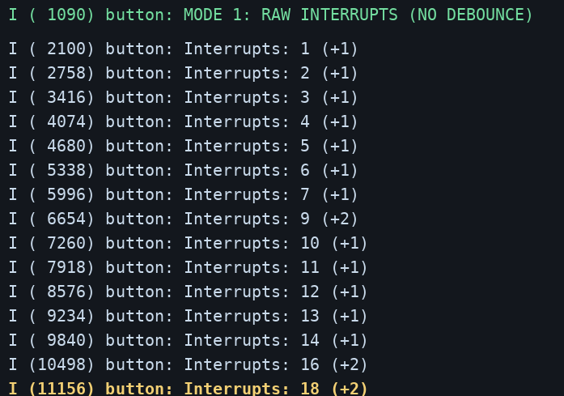
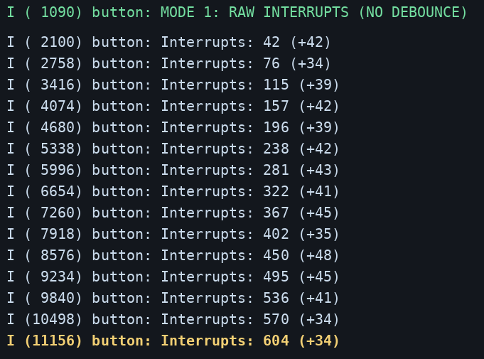
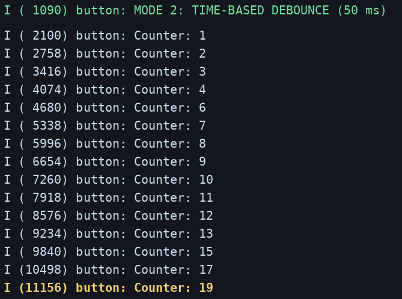
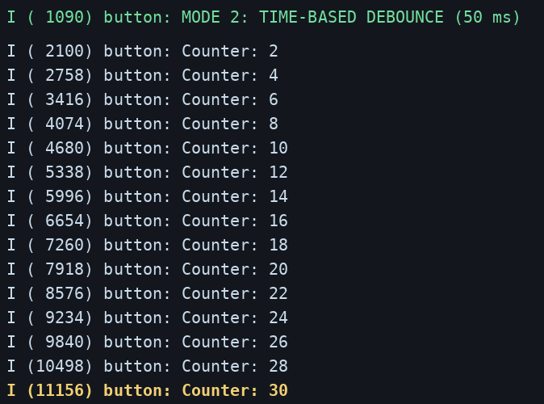
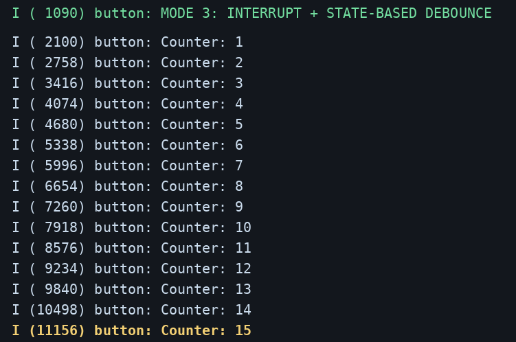
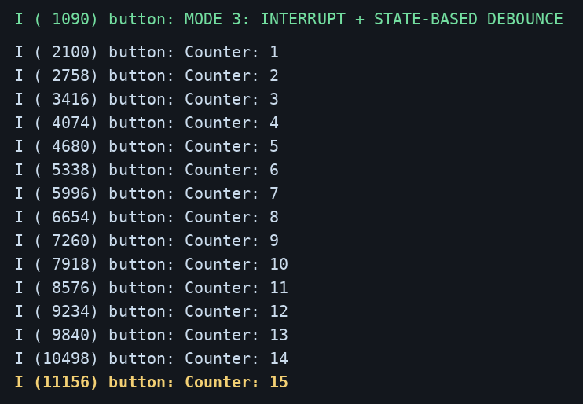
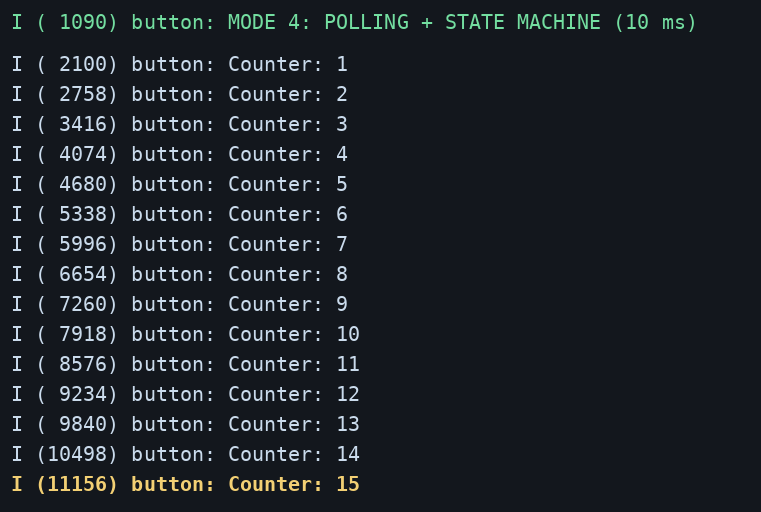
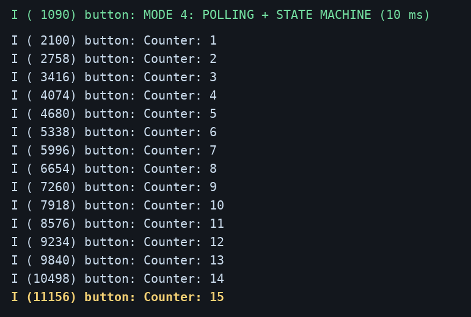

# ESP32-S3 · Button Debounce (ESP-IDF)

**Beetroot Academy — Module 2.6**

Чотири реалізації обробки кнопки на ESP-IDF. Використовується `GPIO 15` з підтягуванням `10 кΩ` до `3.3V`.

## Режими

| `TEST_MODE` | Алгоритм |
|---|---|
| `1` | GPIO interrupt (`FALLING`), без debounce |
| `2` | Time-based debounce — 50 мс |
| `3` | State-based debounce — 50 мс |
| `4` | Polling — 10 мс + машина станів |

Встановити режим у `main/main.c` та запустити:

```bash
idf.py set-target esp32s3
idf.py build flash monitor
```

## Схема

Без RC: `3.3V → 10 кΩ → GPIO15 → кнопка → GND` (резистор між 3.3V і GPIO; кнопка між GPIO і GND).

З RC: `100 Ω` між вузлом кнопки та GPIO15; `100 нФ` між GPIO15 та GND. Зовнішня підтяжка `10 кΩ` залишається на вузлі кнопки.

## Порівняння

Базові значення з попереднього експерименту модуля 2.4; **15 натискань** у кожному тесті.

| Метод | Без RC | З RC | Зайві спрацювання без RC / з RC |
|---|---:|---:|---:|
| Без debounce | 18 | 604 | +3 / +589 |
| Time-based | 19 | 30 | +4 / +15 |
| State-based | 15 | 15 | 0 / 0 |
| Polling | 15 | 15 | 0 / 0 |

## Логи ESP-IDF

| Без RC | З RC |
|---|---|
| **Interrupt**  | **Interrupt**  |
| **Time-based**  | **Time-based**  |
| **State-based**  | **State-based**  |
| **Polling**  | **Polling**  |

## Висновок

Найстабільнішими в попередніх тестах були **State-based** і **Polling**: 15 зарахувань із 15 натискань. Простий time-based фільтр не виключає спрацювань при відпусканні. RC-фільтр без додаткової цифрової обробки не гарантує усунення брязкоту.
